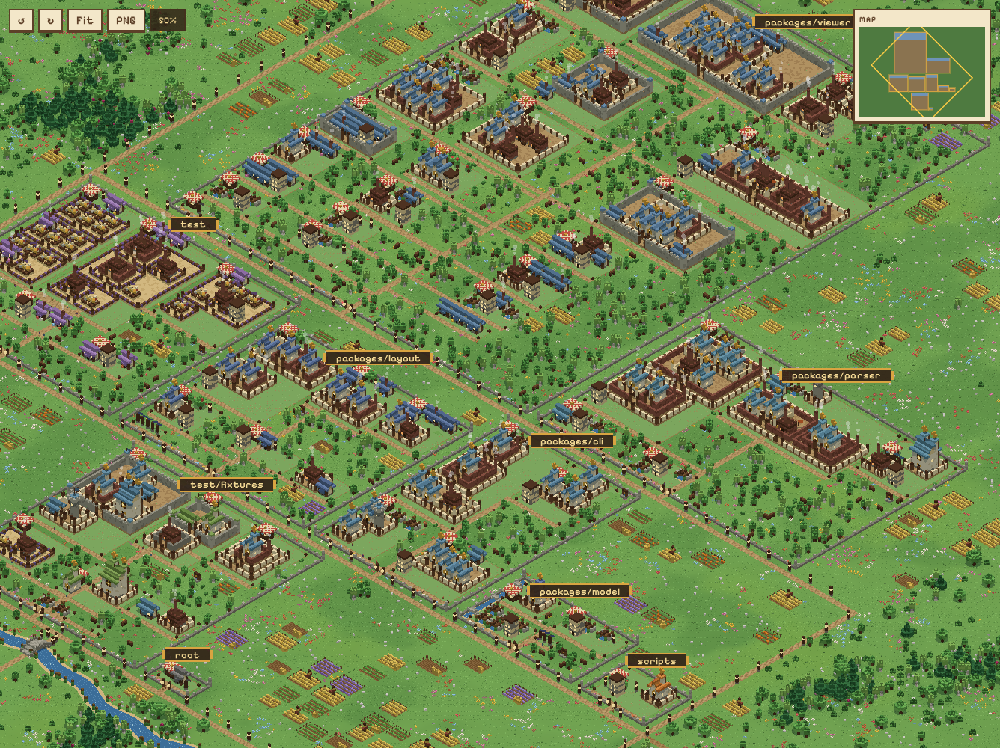
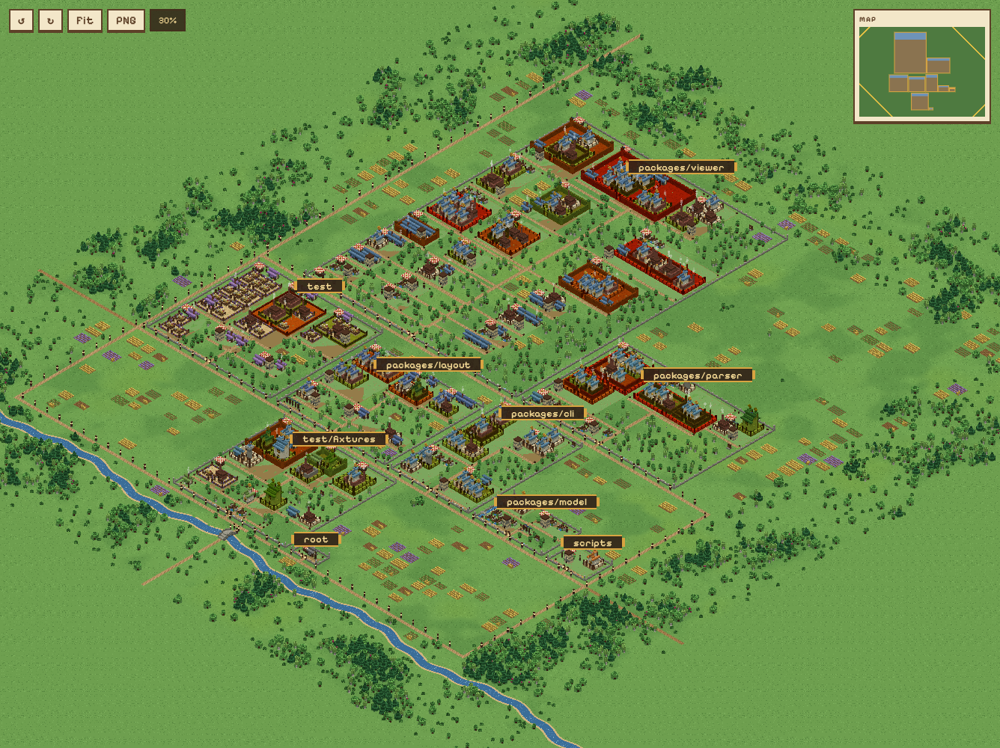
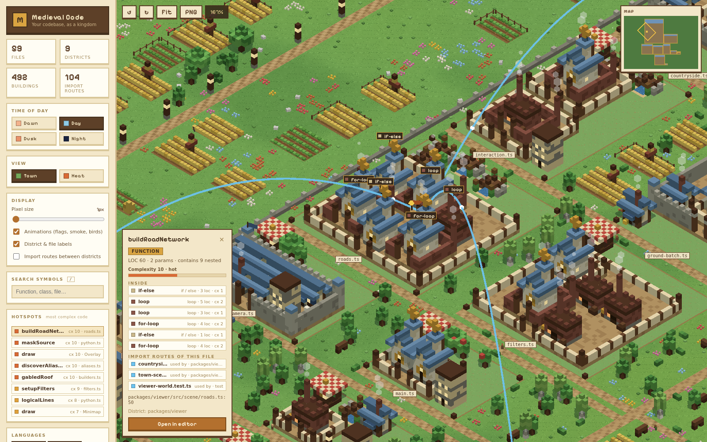
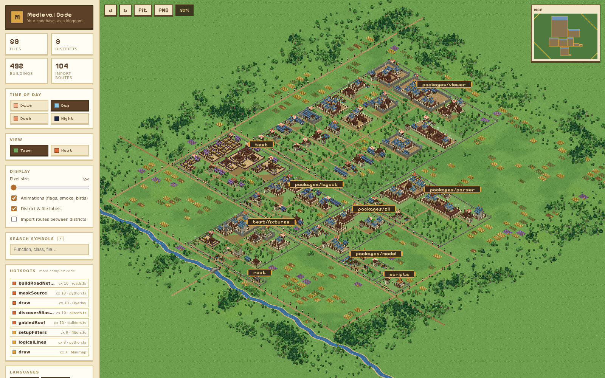
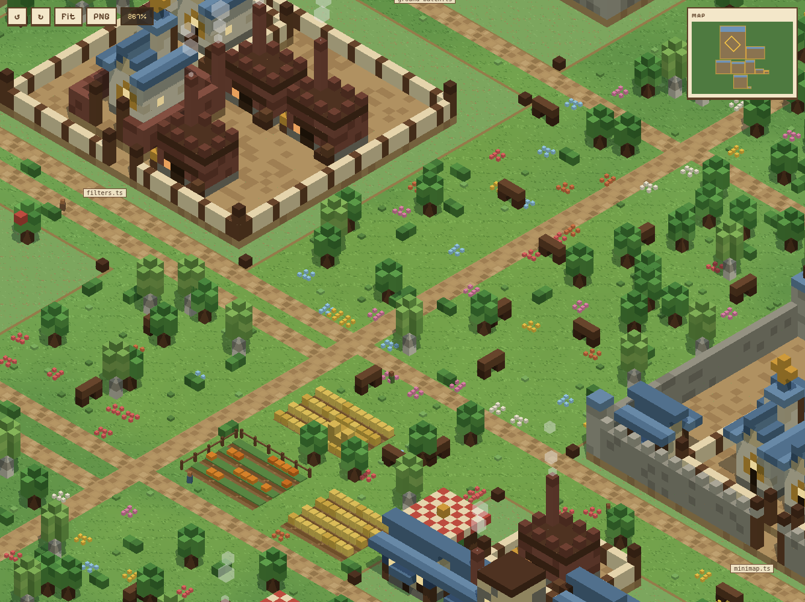
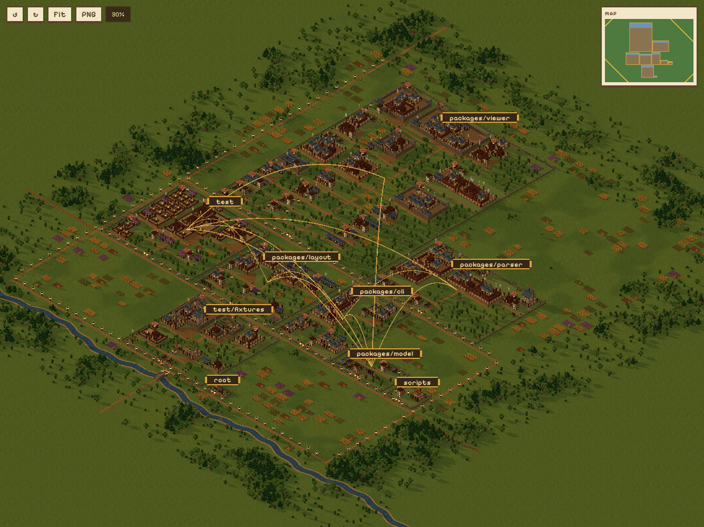
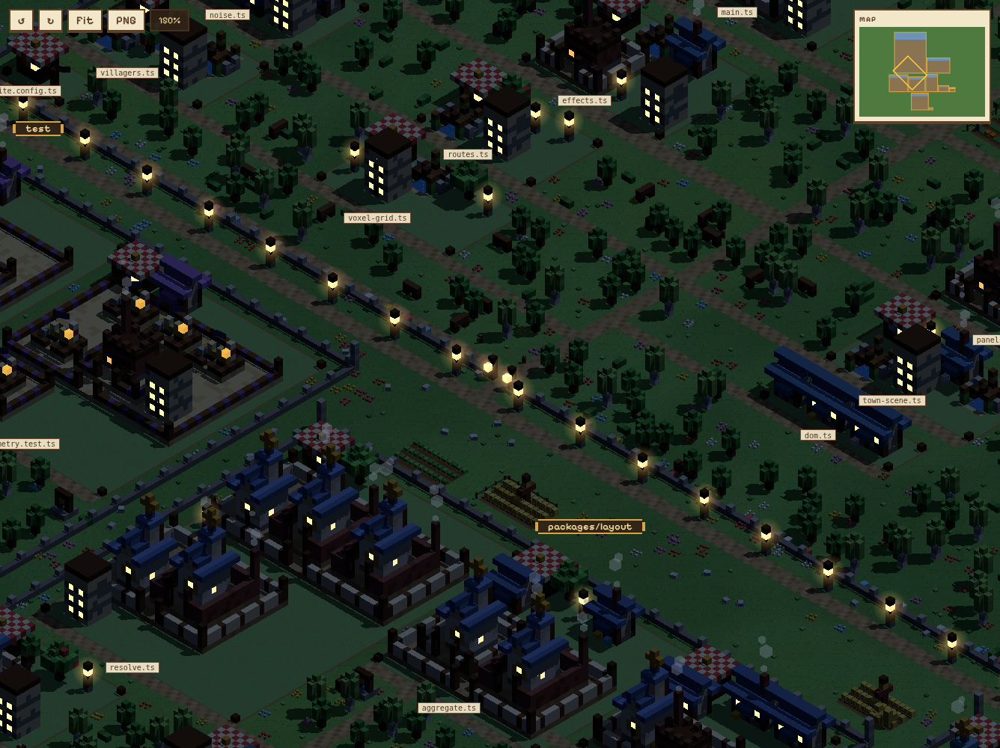

# Medieval Code

**Your codebase as a living medieval town.** Medieval Code parses a repository and raises it as an isometric voxel kingdom you can fly over like an RTS map. Folders become walled wards. Files become plots. Every class, function, loop and branch becomes a building whose shape tells you what it is and how complex it is.



It is a code map you can actually use. The most complex functions burn red in the heat view. Clicking a building shows what it is, and one more click opens its source at the exact line. Arcs through the sky show which files import which.

```bash
npm install && npm run build
node packages/cli/dist/index.js scan ../my-project --open
```

---

## Contents

- [Reading the town](#reading-the-town)
- [What you can do with it](#what-you-can-do-with-it)
- [Gallery](#gallery)
- [Command line](#command-line)
- [Viewer controls](#viewer-controls)
- [What gets parsed](#what-gets-parsed)
- [Large repositories](#large-repositories)
- [Development](#development)

---

## Reading the town

| Code | Building | What its shape tells you |
|---|---|---|
| Top-level folder (two levels deep: `src/api`) | **Ward** with stone walls, a lit gate and gardens | Bigger wards hold more code; the biggest one is the old town at the top |
| Source file | **Plot** of trodden earth with corner posts and a name sign | Buildings stand in source order, left to right |
| `class`, `enum` | **Castle** | Height grows with lines of code; more members add a second banner |
| function, method, arrow function | **House** | Width grows with parameters, height with length; some get a smoking chimney |
| `for`, `while`, `do` | **Workshop**, a brick factory | Smokestacks show how deeply the loop is nested |
| `if` / `else if` / `else` | **Church** | One church per chain, however many branches it has |
| `switch`, Python `match` | **Cathedral** | Twin bell towers |
| `try` / `catch` / `finally` | **Guard tower** | |
| imports | **Market stall** under a striped canopy | One per file |
| `interface`, `type` | **Footbridge** over a little stream | |
| `describe`, `it`, `test`, Python `test_*` | **Training ground** with straw dummies and an archery target | A `describe` block is a fenced drill yard holding its tests |
| top-level `const` | Tree or street lamp | An object full of functions becomes a walled garden of houses |
| `export { … }` | Flag | |
| config file (`package.json`, `vite.config.ts`…) | **Town hall** with a clock tower | |
| overflow past the caps | **Tenement** labelled `+N more` | |

**Nesting is architecture.** A construct that contains other constructs becomes a walled courtyard with its children built inside, recursively. A method inside a class inside a file is a house inside a castle courtyard inside a plot. Rings of walls show nesting depth, and sprawling compounds are big functions. Every nested building can be hovered, clicked and opened on its own line.

**Roof colours are languages.** Slate blue is TypeScript, amber is JavaScript and green is Python. Test files have lavender roofs and config files grey ones.

**Complexity** is a cyclomatic-style score computed from the same tree the town shows. A function starts at 1 and gains a point for each loop, `try`, `switch` case and `if` branch inside it. The buckets are calm (≤2), mild (≤5), warm (≤9), hot (≤15) and burning (16+). Hot and burning street-level buildings fly a warning pennant, even in the normal view.

---

## What you can do with it

**Find the scary code.** The *Hotspots* list in the sidebar ranks the most complex functions. Clicking one flies the camera to it. The **Heat** view tints every building by its score, and burning ones smoulder.



**Understand one function.** Click any building to open its card. The card shows its kind, lines of code and a complexity meter. It also lists everything built inside it, each row clickable, and has an *Open in editor* button that jumps to the exact line in VS Code. Hovering a courtyard floats a name tag over every building inside.

**See dependencies.** Selecting a building also draws its file's import routes as arcs in the sky. Gold arcs go to the files it imports and blue arcs come from the files that import it. Little carts travel each arc towards the dependency. The card lists both sides, and clicking a row jumps to that file. The *Import routes between districts* toggle shows the whole town's dependency graph, with thicker arcs for more imports.



**Search.** Press `/`, type part of a symbol or file name, and pick a result. Enter jumps to the best match, and everything that does not match falls into shadow. A link with `?q=parseFile` opens the town already focused on that symbol.

**Filter.** Toggle languages, building types and districts in the sidebar.

**Share a picture.** The **PNG** button (or `P`) saves the current view with its labels.

---

## Gallery

| | |
|---|---|
|  |  |
| **Overview.** The whole kingdom with stats, hotspots and filters. | **Close-up.** Courtyards, farms, orchards, smoke and flags. |
|  |  |
| **Dusk** with the district import graph switched on. | **Night.** Lit windows, street lamps and file signs. |

The world around the code is generated from the repository path, so every repo gets its own countryside:

- **Wards** stand in rows, and each row's gates open onto a lamp-lit avenue.
- **Ring roads** join the avenues, and the main road crosses a meandering river on a stone bridge.
- **Country roads** lead off the map.
- **Farms** surround the walls: wheat with scarecrows, vegetables, lavender, pumpkins and hay.
- **Forests** of oak, pine and birch grow beyond them, with ragged edges of bushes.
- **Flower meadows** grow in single-colour patches.
- **Gardens** inside the walls have orchards, flower beds, hedges, benches and a well.
- **Townsfolk** walk the streets of their own ward.
- **Four times of day** set the light: dawn, day, dusk and night.

---

## Command line

```
medieval-code scan <path> [options]     parse a repo and write town.json
medieval-code serve [town.json | repo]  show an existing town.json
```

| `scan` option | |
|---|---|
| `-o, --out <file>` | Output path. Default: `<repo>/.medieval-code/town.json` |
| `--open` | Serve the viewer and open it in the browser |
| `--serve` | Serve the viewer without opening a browser |
| `-p, --port <n>` | Viewer port, default 5179. The next free port is used if it is busy |
| `--theme <t>` | `dawn`, `day`, `dusk` or `night` |
| `--max-files <n>` | Maximum source files to parse. Default 500 |

`serve` takes `--port`, `--theme` and `--no-open`. It reads `town.json` on every request, so re-running `scan` and reloading the page shows the new town.

Every scan prints a summary with the town's hottest functions:

```
Town written to .medieval-code/town.json in 254 ms
  9 districts · 59 files · 492 buildings · 104 import routes
  Hotspots (most complex functions):
    cx  10  buildRoadNetwork  packages/viewer/src/scene/roads.ts:50
    cx  10  maskSource        packages/parser/src/languages/python.ts:37
    cx  10  draw              packages/viewer/src/ui/overlay.ts:39
    cx  10  discoverAliases   packages/parser/src/aliases.ts:35
    cx  10  gabledRoof        packages/viewer/src/scene/builders.ts:41
```

**Configuration.** An optional `.medieval-code.json` at the repo root sets defaults. Command-line options win over it:

```json
{
  "maxFiles": 500,
  "maxConstructsPerFile": 80,
  "maxRowWidth": 512,
  "excludeGlobs": ["legacy/**", "**/*.generated.ts"],
  "theme": "dusk"
}
```

---

## Viewer controls

| Input | Action |
|---|---|
| Drag, arrow keys | Pan |
| Scroll | Zoom |
| `Q` / `E` | Rotate 45° |
| `F` | Fit the town |
| `R` | Reset the camera |
| `/` | Search |
| `P` | Save a PNG |
| `Esc` | Close the selection |
| Click a building | Select it: card, camera glide, import routes |
| Click the minimap | Fly there |

URL parameters: `?theme=night`, `?view=heat`, `?routes=1` (district import graph) and `?q=symbol` (open focused on a symbol).

The *Display* panel sets the pixel size (1 is crisp native resolution, higher is chunkier retro pixels) and toggles animation and labels. With animation off, the viewer draws only when something changes.

---

## What gets parsed

| Language | Extensions | How |
|---|---|---|
| TypeScript, JavaScript | `.ts` `.tsx` `.js` `.jsx` `.mjs` `.cjs` | The TypeScript compiler API |
| Python | `.py` | An indentation-aware extractor |

**TypeScript and JavaScript.** The extractor finds these constructs:

- **Types:** classes, enums, interfaces and type aliases.
- **Functions:** declarations, methods, constructors, getters and setters, and arrow functions assigned to a `const` at any depth.
- **Objects of functions:** `const api = { get() {}, post: () => {} }`.
- **Control flow:** loops, `if` chains, `switch` and `try`.
- **Tests:** `describe`, `it` and `test` blocks, including `.only`, `.skip` and `test.each(...)`.

**Python.** The extractor blanks strings and comments first and folds bracketed continuation lines, so a docstring cannot open a block and a black-formatted multi-line signature does not end its function early. It reads:

- **Definitions:** classes with their member counts, and functions with parameter counts (ignoring `self` and `cls`).
- **Control flow:** `for`/`while` (with `else`), `if`/`elif`/`else`, `try`/`except`/`else`/`finally`, and `match`/`case`.
- **The rest:** the `__main__` guard, top-level constants, and test functions and classes.

**Imports become routes.** Relative imports resolve to files, including `./x.js` pointing at `x.ts`, and `index` files. So do `tsconfig.json`/`jsconfig.json` `paths` aliases such as `@/lib/x`, workspace packages like `@scope/pkg` in a monorepo, and Python relative and absolute module imports.

**What is left out:**

- Everything in the root `.gitignore`.
- `node_modules`, `dist`, `build`, `vendor`, virtual environments and other build folders.
- Minified or bundled files: `*.min.js`, `*.bundle.js`, and files whose average line is very long.
- `.d.ts` declaration files and files over 768 KB.

The scan summary says how many files were skipped.

---

## Large repositories

The defaults cap a scan at 500 files and 80 buildings per file. Courtyards over six buildings collapse their extra buildings into a tenement. The viewer is built to keep big towns fluid:

- **Buildings:** every building is one instance of a single `BatchedMesh`. Filters, hover and heat are per-instance colours, not separate meshes.
- **Voxel models:** greedy meshing merges same-coloured faces, so a courtyard floor costs a few triangles instead of two per voxel.
- **Trees, crops, flowers, lamps, flags and smoke:** all instanced. The ground clutter is split into spatial chunks for culling and hidden when it would be smaller than a pixel.
- **Ground:** paths, plots and fields are batched into one mesh per ward.
- **Shadows:** the shadow map follows the camera, so it stays sharp at any zoom.

Measured on the 500 files of three.js's own source, with 40 wards and 4,532 buildings, at the fit view. "Unbatched" is the same scene with one mesh per building, flag, lamp and scatter chunk:

| | Unbatched | Now |
|---|---|---|
| Draw calls per frame | 22,374 | 384 |
| Triangles per frame, shadows included | 9.9 M | 4.4 M |

The scan itself takes about 1.1 s for those 500 files.

---

## Development

```
CLI scan ─► parser ─► layout ─► town.json ─► viewer (Three.js)
```

| Package | Role |
|---|---|
| `@medieval-code/model` | `TownModel` types, the shared voxel footprints and the courtyard layout. Layout and viewer must agree on these, so they live here |
| `@medieval-code/parser` | File walker, generated-file detection, import aliases, and the TypeScript and Python extractors with complexity scoring |
| `@medieval-code/layout` | Plots and wards, district packing into bottom-aligned rows, and import resolution to file and district edges |
| `@medieval-code/cli` | The `scan` and `serve` commands, the static server and the terminal summary |
| `@medieval-code/viewer` | Three.js renderer and UI. The `src/scene/` folder holds the buildings, countryside, roads, routes, effects and camera |

| Command | |
|---|---|
| `npm run build` | Build every package. The viewer goes to `packages/viewer/dist` |
| `npm test` | Unit and integration tests (vitest), run against the TypeScript sources with no build needed |
| `npm run typecheck` | Typecheck every package |
| `npm run test:browser` | Scan this repo and drive the real viewer in headless Chromium. Fails on any page error or broken interaction. Needs `npm run build` |
| `npm run docs:images` | Run the browser check and regenerate the screenshots in `docs/images/` |
| `npm run dev` | Vite dev server for the viewer. It proxies `/town.json` to port 5180, so run `medieval-code serve -p 5180` alongside it |

The tests cover the following:

- **Parsers:** the TypeScript and Python extractors on tricky input such as docstrings, black-style signatures, `if` chains and test suites.
- **Complexity scoring.**
- **Walker:** sorting, caps and generated-file skipping.
- **Layout guarantees:** no overlapping wards, plots or buildings, footprints matching the viewer, and gates aligned to avenues. They run on a fixture and on this repository itself.
- **Determinism.**
- **Import resolution:** relative imports, `index` files, `.js` to `.ts`, tsconfig paths, workspace packages and Python modules.
- **Road network:** no road crosses a ward.
- **Voxel meshing:** greedy merging, hidden-face culling and outward winding, plus the ground batches.
- **Scan and server, end to end:** config files, the summary, path-traversal protection, and live reload of `town.json`.

The browser check runs on SwiftShader, so it works without a GPU. It is slow there; a real GPU renders the same scenes many times faster.

## License

MIT. See [LICENSE](LICENSE).
